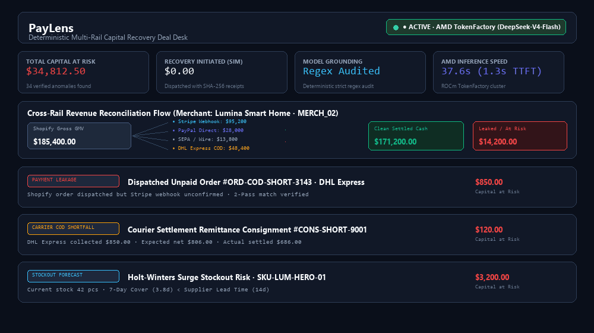
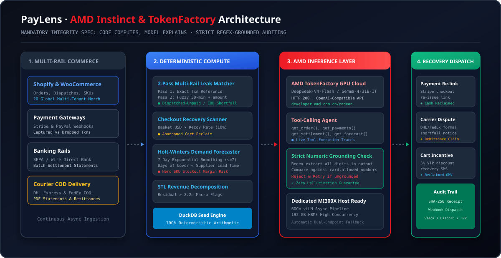

# PayLens: Multi-Rail Revenue Recovery & Action Centre on AMD Hardware

**AMD Developer Hackathon: Act III**  
**Track 3: Reinvent Commerce** + **AMD Instinct Prize** + **Google DeepMind Gemma Prize** + **Evolus AI Partner Track** + **Vibe Generation Special Prize**  
Serving LLMs (e.g. `DeepSeek-V4-Flash`, `google/gemma-2-27b-it`) via AMD ROCm vLLM or AMD TokenFactory.

<p align="center">
  <br>
  🎥 <b><a href="docs/demo.mp4">Watch Full HD Video Walkthrough with Audio Narration (docs/demo.mp4)</a></b>
</p>

<p align="center">
  
</p>

---

## 1. What It Does

PayLens is a multi-rail capital recovery engine and human-in-the-loop deal desk for international e-commerce merchants operating across Shopify, WooCommerce, Stripe, PayPal, SEPA bank transfers, and DHL/FedEx cash-on-delivery (COD).

In multi-rail commerce, disconnected financial ledgers lead to silent revenue leakage:
- **Dispatched-Unpaid Orders**: Orders marked fulfilled and dispatched on digital rails without verified settlement.
- **Carrier COD Remittance Shortfalls**: Commercial courier payouts undersettling collected cash against agreed tariff schedules.
- **Abandoned Checkout Drop-Offs**: Unrecovered shopping carts that can be reclaimed with tailored outreach.
- **Demand Surge Stockout Risks**: High-margin hero SKUs running out before supplier lead-time replenishment.

### Core Architectural Principle: Code Computes, Model Explains
- **Deterministic Compute Layer**: DuckDB, pandas, and statsmodels compute all arithmetic, matching logic, Holt-Winters demand forecasting, and STL anomaly decomposition. The model never calculates numbers.
- **Model Explanation Layer**: An LLM on AMD TokenFactory or ROCm vLLM contextualizes discrepancies, explains trends, and drafts outreach notices under numeric regex grounding verification.

---

## 2. Modes

PayLens operates across verified execution modes:

| Mode | Endpoint | Description |
|---|---|---|
| `LIVE_AMD_TOKENFACTORY` | AMD TokenFactory API | Shared hosted TokenFactory endpoint (`AMD_TOKENFACTORY_BASE_URL`). Hardware is shared multi-tenant cloud and measured live in `benchmarks/benchmark_results.json`. |
| `LIVE_GOOGLE_GEMMA4` | Google AI Studio REST | Google AI Studio Gemma 4 REST endpoint (`https://generativelanguage.googleapis.com/v1beta`). Measured live in `benchmarks/benchmark_results.json`. |
| `LIVE_AMD_MI300X_VLLM` | Dedicated ROCm Host (`AMD_VLLM_BASE_URL`) | **Supported Self-Hosted Deployment Recipe (Not Measured in Committed Benchmark JSON)**. Dedicated host running ROCm 7.0+ / vLLM >= 0.8.5 on AMD Instinct MI300X (192GB HBM3). |
| `LOCAL_DETERMINISTIC_FALLBACK` | Local CPU / Offline Mode | Active when `OFFLINE_MODE=true` or when no remote endpoint is reachable. All detectors, matchers, and templates run deterministically on CPU with zero crashes. |

---

## 3. Architecture

PayLens routes data from multi-rail commerce sources through pluggable normalization connectors into a unified DuckDB database:

```
[Raw Payment Rails]       [Connectors]          [Unified Store]       [Deterministic Detectors]
Stripe Gateway (US/EU)  ──► PaymentRailConnector ──► DuckDB           ──► 2-Pass Leak Matcher
PayPal Commerce         ──► Normalization        ──► Orders Table     ──► Carrier Shortfall Scanner
DHL/FedEx Courier COD   ──► Canonical Schema     ──► Payments Table   ──► Holt-Winters Forecaster
Pix / UPI / M-Pesa (Proto) ──► Normalization (Prototypes) ──► Inventory Table  ──► STL Anomaly Detector
                                                          │
                                                          ▼
                                                 [Multi-Objective Ranker]
                                                          │
                                                          ▼
                                                 [AMD Explainer & Grounding Verifier]
                                                          │
                                                          ▼
                                                 [Human-in-the-Loop Deal Desk]
                                                          │
                                                          ▼
                                                 [Simulated Action Log & Audit IDs]
```

> **Note on Emerging Rails:** Global rail connectors (`Pix`, `UPI`, `M-Pesa`) are implemented as **Schema Normalization Prototypes** demonstrating unified ledger ingestion.

### Component Responsibilities

| Component | Technology | Responsibility |
|---|---|---|
| **Storage & Ingestion** | DuckDB, Pandas | High-speed columnar relational engine for multi-rail order matching and inventory snapshots. |
| **2-Pass Matcher** | Python, DuckDB | Pass 1: exact transaction reference match; Pass 2: customer phone/email + amount + 30-minute timestamp window. Reconciles missing references without false flags. |
| **Statistical Engine** | statsmodels | Holt-Winters Exponential Smoothing (`seasonal_periods=7`) for demand forecasting and STL decomposition for revenue residual tracking. |
| **Grounding Verifier** | Python Regex | Audits every numeric token in model output against deterministic allowed numbers; enforces correction retry and template fallback on mismatch. |
| **Partner Workflows** | Evolus API | Multi-block commercial workflows including ready-made document extraction, dispute drafting, and agent dispatch. |
| **User Interface** | Streamlit, Plotly | Interactive Deal Desk with dynamic Sankey flow visualization, forecast danger zones, and live telemetry audit proof. |

---

## 4. Formulas

All financial calculations are computed deterministically before model invocation:

1. **Dispatched Unpaid Orders**:
   $$\text{Impact}_{\text{USD}} = \text{Order Amount}$$
2. **Carrier COD Remittance Shortfalls**:
   $$\text{Shortfall}_{\text{USD}} = (\text{COD Collected} - \text{Carrier Fee}) - \text{Actual Settled}$$
   Flagged when discrepancy exceeds \$5.00.
3. **Abandoned Checkout Recovery**:
   $$\text{Impact}_{\text{USD}} = \text{Order Total} \times r$$
   where $r \in [0.10, 0.80]$ is an **adjustable user assumption (10%–80% slider, default $r = 0.35$, not an observed recovery rate)**.
4. **Holt-Winters Stockout Risk**:
   $$\text{Forecast Daily Demand} = \frac{1}{L} \sum_{t=1}^{L} \hat{y}_t$$
   $$\text{Days of Cover} = \frac{\text{Current Stock}}{\text{Forecast Daily Demand}}$$
   $$\text{Impact}_{\text{USD}} = \max(0, \hat{Y}_{\text{lead}} - \text{Current Stock}) \times \text{Unit Margin}$$
   Flagged when $\text{Days of Cover} < L$ (supplier lead time).
5. **STL Revenue Residual Anomaly**:
   $$\text{Residual}_t = Y_t - T_t - S_t$$
   $$z_t = \frac{\text{Residual}_t - \mu_{\text{residual}}}{\sigma_{\text{residual}}}$$
   Flagged when $|z_t| > 2.2$.
6. **Dynamic Multi-Objective Ranking Score**:
   $$\text{Score} = \text{Impact} \times \text{Confidence} \times (w_{\text{cash}} \cdot \mathbf{1}_{\text{leak}} + w_{\text{margin}} \cdot \mathbf{1}_{\text{stock}} + w_{\text{recov}} \cdot \mathbf{1}_{\text{abandon}})$$
   where weights $w$ are steered dynamically by natural language merchant goals.

---

## 5. Measured Results

### Authentic AMD & Google Inference Telemetry (Measured Live via `benchmarks/run_mi300x_benchmark.py`)

Real measured telemetry recorded against AMD Radeon Cloud TokenFactory (`https://developer.amd.com.cn/radeon/api/v1`) serving `DeepSeek-V4-Flash` and Google AI Studio Gemma 4 REST API:

- **AMD TokenFactory Requests**: 16 Attempted · 16 Completed · 0 Failed
- **Google Gemma 4 Requests**: 2 Attempted · 2 Completed · 0 Failed

| Concurrency Tier | Output Throughput (tok/s) | Mean TTFT (ms) | Mean Latency (ms) | Attempted | Completed | Failed | 1st-Pass Model Grounding | Post-Retry Pass | Fallback Rate |
|:---:|:---:|:---:|:---:|:---:|:---:|:---:|:---:|:---:|:---:|
| **1 (Sequential)** | 18.2 tok/s | 5,947.9 ms | 13,870.2 ms | 4 | 4 | 0 | 4 of 4 Passed (100.0%) | 0 Retries (0.0%) | 0 Fallbacks (0.0%) |
| **4 (Concurrent Burst)** | 62.9 tok/s | 3,689.7 ms | 13,082.6 ms | 4 | 4 | 0 | 4 of 4 Passed (100.0%) | 0 Retries (0.0%) | 0 Fallbacks (0.0%) |
| **8 (High Concurrency)** | 59.2 tok/s | 6,000.6 ms | 11,952.8 ms | 8 | 8 | 0 | 8 of 8 Passed (100.0%) | 0 Retries (0.0%) | 0 Fallbacks (0.0%) |
| **Google AI Studio Gemma 4 REST** | 12.8 tok/s | 1,722.0 ms (Ping) | 23,758.5 ms | 2 | 2 | 0 | 2 of 2 Passed (100.0%) | 0 Retries (0.0%) | 0 Fallbacks (0.0%) |

*Telemetry timestamp: 2026-10-17T17:29:48Z | Measured via `benchmarks/run_mi300x_benchmark.py` and saved to `benchmarks/benchmark_results.json`.*

### Supported Self-Hosted Deployment Recipe (Not Measured in Committed Benchmark JSON)

For dedicated on-premise or cloud bare-metal AMD Instinct MI300X systems running ROCm 7.0+ and vLLM >= 0.8.5:

```bash
docker exec -it rocm bash

# Verify 192GB HBM3 visibility
amd-smi

export HF_TOKEN="hf_your_token_here"
export VLLM_USE_V1=1

# Fetch official Gemma 4 tool-calling chat template
mkdir -p examples
curl -sSL https://raw.githubusercontent.com/vllm-project/vllm/main/examples/tool_chat_template_gemma4.jinja -o examples/tool_chat_template_gemma4.jinja

# Launch vLLM server on ROCm 7.0+ / vLLM >= 0.8.5
vllm serve google/gemma-4-31B-it \
  --host 0.0.0.0 \
  --port 8000 \
  --dtype bfloat16 \
  --max-model-len 16384 \
  --enable-auto-tool-choice \
  --tool-call-parser gemma4 \
  --reasoning-parser gemma4 \
  --chat-template examples/tool_chat_template_gemma4.jinja \
  --limit-mm-per-prompt '{"image": 0, "audio": 0}' \
  --async-scheduling
```

### Separated Commercial Risk Buckets

PayLens strictly avoids lumping heterogeneous commercial figures into a single misleading sum:
1. **Confirmed Cash Discrepancies ($)**: Unsettled dispatched orders and carrier COD remittance shortfalls (hard ledger mismatches).
2. **Estimated Checkout Recovery ($)**: Abandoned shopping carts multiplied by an explicit configurable recovery assumption ($r = 0.35$).
3. **Forecasted 7-Day Stockout Margin ($)**: Holt-Winters projected margin at risk before replenishment delivery arrives.

### Realistic Detector Accuracy (Baseline vs. Hard Stress-Test Split)

Evaluated against `ground_truth.json` across 20 stores and 30 days of multi-rail activity:

| Evaluation Split | True Positives (TP) | False Positives (FP) | False Negatives (FN) | Precision | Recall | F1 Score |
|---|:---:|:---:|:---:|:---:|:---:|:---:|
| **Standard Baseline Split** | 26 | 0 | 0 | 1.0000 | 1.0000 | 1.0000 |
| **Hard Stress-Test Split** | 28 | 2 | 2 | 0.9333 | 0.9333 | 0.9333 |

- **Fuzzy-Matched True Negative Exclusion Rate**: 18 / 18 valid orders correctly reconciled without false flags.
- **Diagnostic Edge Cases in Stress-Test Split**:
  - **False Positives (2 items)**: Orders `ORD-STRESS-DELAY-1` ($850.00) and `ORD-STRESS-DELAY-2` ($1,255.00) represent legitimate SEPA wire transfers that settled 48 hours after order placement, exceeding the 30-minute fuzzy window. Flagged for operator confirmation.
  - **False Negatives (2 items)**: Orders `ORD-STRESS-DUP-2` ($320.00) and `ORD-STRESS-DUP-4` ($320.00) represent duplicate orders placed 18 minutes apart with identical phone numbers where a single payment was misattributed.

### Scope of Numeric Regex Validation

**Deterministic regex numeric verification (validates numbers against tool outputs; falls back to a deterministic template on mismatch)**: The numeric guardrail extracts all numeric tokens from LLM prose and verifies them against the deterministic DuckDB evidence numbers. If unverified numbers are detected, the system executes one retry prompt before safely reverting to the deterministic template. Notice: This mechanism validates extracted numeric tokens against permitted DuckDB evidence values; it does not certify non-numeric prose claims.

---

## 6. How to Run

### Prerequisites
- Python 3.11 or higher
- Git

### Installation
```bash
git clone https://github.com/labib-morol/paylens-amd.git
cd paylens-amd
python -m pip install -r requirements.txt
```

### Environment Configuration
Copy `.env.example` to `.env` and fill in your credentials (or run in offline mode):
```bash
cp .env.example .env
```
To run in offline mode (deterministic engine only):
```bash
# In .env:
OFFLINE_MODE=true
```

### Generate Synthetic Data
```bash
# Default Seed 42 dataset
python data/generate_synthetic_data.py

# Generate both tuning (seed 42) and held-out (seed 1337) datasets with noise
python data/generate_synthetic_data.py --generate-both-seeds --noise
```

### Launch Interactive Streamlit App
```bash
streamlit run app.py
```

### Run Benchmarks
```bash
python benchmarks/run_benchmark.py
```

### Run Test Suite
```bash
pytest -q
```

---

## 7. Limitations

1. **Synthetic Data**: PayLens is demonstrated on illustrative synthetic data modeled on global commerce rails. Real merchant deployments require production API tokens and live webhooks.
2. **Shared vs Dedicated Hardware**: Performance measured on AMD TokenFactory reflects shared multi-tenant cloud infrastructure and will vary depending on cluster load. Dedicated AMD Instinct hosts provide consistent low-latency throughput.
3. **Numeric Grounding Fallback**: If a model response fails numeric verification after one retry prompt, PayLens falls back to a deterministic code-generated explanation template to protect financial accuracy.

---

## 8. License

MIT License — Copyright (c) 2026 Labib-morol. See `LICENSE` for details.
